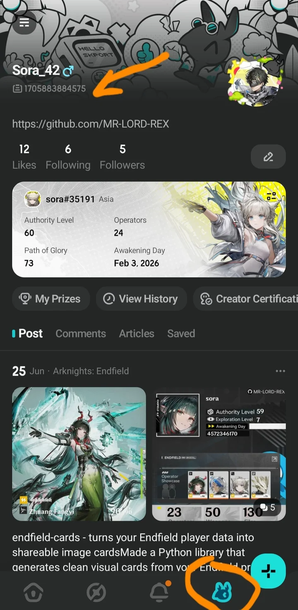
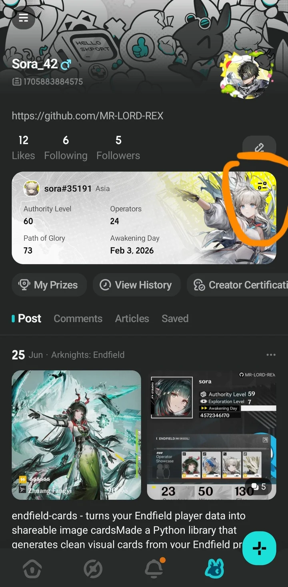
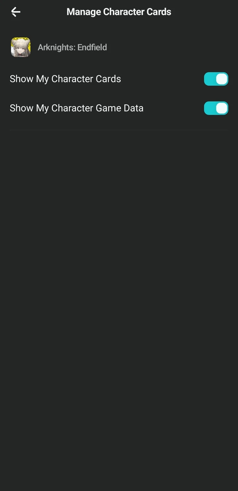
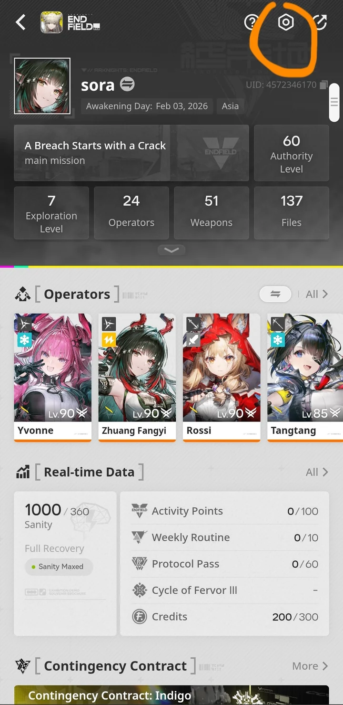
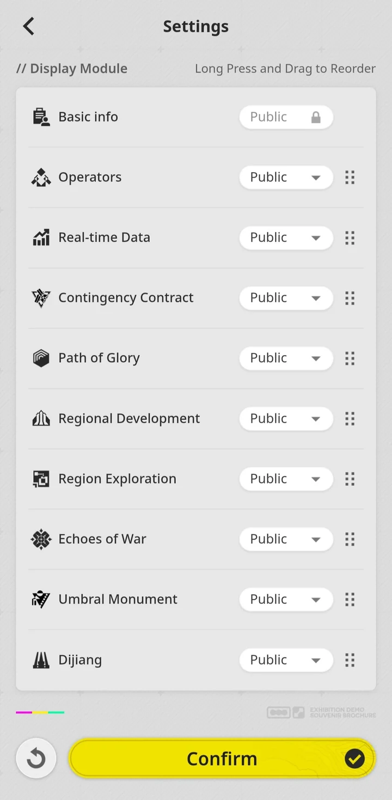

# SKPORT ID and privacy

Use the official SKPORT app to find your profile ID and choose which Endfield
information other users can access. Public SDK requests follow these settings.

## Install and sign in

1. Download **SKPORT**, the official Arknights community app, from your device's
   app store.
2. Sign in with the **same Gryphline account you use for Arknights: Endfield**.
3. Open the **profile tab** at the bottom right of the app.

## Copy your SKPORT ID

Your SKPORT ID is the number beneath your profile username. Tap the **copy icon**
beside that number, as marked in the screenshot, and use the copied value as
`SKPORT_ID` or the client's `skport_id` argument.

<figure class="app-screenshot">
  <a href="../assets/imgs/skport-id.png" target="_blank" rel="noopener noreferrer">
    
  </a>
  <figcaption>Open your profile and copy the number beneath your username. Select the image to view the original.</figcaption>
</figure>

The screenshot shows a **SKPORT ID**, which identifies a public profile. It is
different from the **account token** used to authenticate SDK requests and from
your in-game UID. Obtain that token through the official website as described in
[Account tokens](../getting-started/account-tokens.md).

## Global privacy: allow access to your card

The **1.x screenshots** show the global card visibility controls. Configure these
before changing individual sections.

1. On your profile, tap the **card-management icon** at the upper right of the
   Endfield card, marked in screenshot 1.1.
2. In **Manage Character Cards**, enable **Show My Character Cards** to make the
   card visible to other users.
3. Enable **Show My Character Game Data** to allow access to the card's game data.

Enable both controls when you want other users to read your public Endfield card
and build data. A separate viewer account's token can authenticate those requests
while your game account's token stays out of the public pool.

<div class="screenshot-grid">
  <figure class="app-screenshot">
    <a href="../assets/imgs/privacy-1.1.png" target="_blank" rel="noopener noreferrer">
      
    </a>
    <figcaption><strong>1.1</strong> Open the Endfield card's management controls from your profile.</figcaption>
  </figure>
  <figure class="app-screenshot">
    <a href="../assets/imgs/privacy-1.2.png" target="_blank" rel="noopener noreferrer">
      
    </a>
    <figcaption><strong>1.2</strong> Enable global card visibility and game-data access.</figcaption>
  </figure>
</div>

## Section privacy: choose which data is public

The **2.x screenshots** show the settings for individual sections inside your
Endfield card.

1. Open the **Endfield card** from your profile.
2. Tap the **settings icon** at the upper right of the detailed card, marked in
   screenshot 2.1.
3. Under **Display Module**, use each section's dropdown to choose its visibility.
   Set the sections you want the public client to read to **Public**.
4. Tap **Confirm** at the bottom to save your choices.

<div class="screenshot-grid">
  <figure class="app-screenshot">
    <a href="../assets/imgs/privacy-2.1.png" target="_blank" rel="noopener noreferrer">
      
    </a>
    <figcaption><strong>2.1</strong> Open settings inside the Endfield card.</figcaption>
  </figure>
  <figure class="app-screenshot">
    <a href="../assets/imgs/privacy-2.2.png" target="_blank" rel="noopener noreferrer">
      
    </a>
    <figcaption><strong>2.2</strong> Choose Public for the required sections, then tap Confirm.</figcaption>
  </figure>
</div>

For example, make **Operators** public for character builds, **Real-time Data**
for activity information, and the relevant progression or event sections for
their reports. Other sections can keep the visibility you prefer.

Section privacy works within the global visibility controls. Setting a section
to **Public** does not override disabled global card or game-data access.

If you prefer to keep your card private, use the game account's token with
[owner methods](owner-accounts.md) for your own account data instead of enabling
public visibility. These methods stay bound to the supplied account.

## Check your setup

After saving your settings, use your copied ID in a public request:

```python
user = await client.endfield.verify_skid(skport_id)
card = await client.endfield.card(skport_id=user.skport_id)
```

Verification checks the social profile and game binding. It does not prove every
card section is public. If a card or section is unavailable, check both privacy
levels and see [errors and retries](errors-and-retries.md).

Continue with the [quickstart](../getting-started/quickstart.md) or
[public profiles](public-profiles.md).
